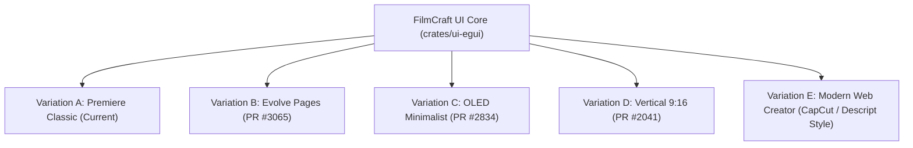

# FilmCraft UI Variations & Modernization Blueprint

## Executive Summary
This document analyzes the UI ecosystem of FilmCraft, categorizes all existing community- and maintainer-built UI variations, evaluates whether modernization risks ruining the software's feel, and lays out a concrete plan to give you the best of both worlds: modern web ergonomics without sacrificing professional NLE power.

---

## 1. Remote GitHub Status Check
We performed a deep audit across all remotes and GitHub API endpoints:
- **`origin/main`** & **`origin/local/filmcraft-coop`**: Exact match at commit `94174562` (containing Web Polish Tickets 1–6).
- **`origin/gh-pages`**: Deployed at commit `488370a7` (hosting live WASM artifacts).
- **Incoming Remote Commits**: **0 new commits found** on GitHub.
> [!NOTE]
> If you made changes on your other laptop, they have not yet been pushed to GitHub. On your other laptop, run:
> ```bash
> git status
> git add -A
> git commit -m "your commit message"
> git push origin <your-branch-name>
> ```
> Once pushed, we can pull and merge them seamlessly into this workspace.

---

## 2. Existing Variations of the FilmCraft UI

Our investigation of the repository, upstream PRs, and community forks revealed **5 distinct UI variations** built for FilmCraft:



### Variation A: Premiere Classic (Current Default)
* **Inspiration:** Adobe Premiere Pro 2026 (`26.5.2`)
* **Layout:** Highly modular dockable split tree with 9 built-in workspaces (`Editing`, `Assembly`, `Color`, `Effects`, `Audio`, `Captions and Graphics`, `Learning`, `Review`, `All Panels`).
* **Visuals:** Dark `#1d1d1d` panels, dense top tab strips with `≡` hamburger menus, thin draggable splitter gutters, blue focus outlines.
* **Strengths:** Maximum tool density, dual-monitor undocking, familiar to seasoned desktop editors.
* **Weaknesses:** Steep learning curve, visual clutter on smaller laptop screens or embedded web viewports.

### Variation B: "Evolve" Pages (PR #3065 by admbe)
* **Inspiration:** DaVinci Resolve
* **Layout:** Replaces the cluttered top workspace dropdown with a streamlined **bottom page bar** featuring 6 dedicated task pages:
  1. **Media** (Ingest, bin organization, clip preview)
  2. **Cut** (Fast rough-cut trimming with dual timeline overview)
  3. **Edit** (Full multi-track NLE editing)
  4. **Color** (Lumetri grading, scopes, wheels)
  5. **Audio** (Fairlight-style audio channel strips & EQ)
  6. **Deliver** (Export queue, preset formats, rendering status)
* **Visuals:** Charcoal theme, warm orange accents, red playhead, high-contrast WCAG AA certified text.
* **Keyboard:** Native DaVinci Resolve keyboard shortcut preset.
* **Status:** Fully functional PR in review upstream.

### Variation C: "OLED Minimalist" (PR #2834 by justacalico)
* **Inspiration:** Apple Pro Display XDR & Studio Display Dark Modes
* **Layout:** Maintains standard docking but uses pure `#000000` pitch-black panel backgrounds.
* **Visuals:** Subtle 1px boundary lines and recessed wells (`#111111`) carry separation without heavy grey chrome.
* **Strengths:** Zero backlight bleed on OLED/Mini-LED displays, dramatically reduces battery consumption and eye strain, feels ultra-clean and modern.

### Variation D: "Vertical 9:16 Creator" (PR #2041 & Issue #1247)
* **Inspiration:** CapCut Desktop, TikTok Studio, Premiere Vertical Workspace
* **Layout:** Centered tall 9:16 Program Monitor flanked by a streamlined vertical inspector on the left and stacked short-form audio/video tracks on the bottom.
* **Strengths:** Essential for editing Reels, Shorts, and TikToks where horizontal 16:9 monitors waste 70% of screen real estate.

### Variation E: Modern Web Creator (CapCut / Descript / Canva Style)
* **Inspiration:** Commercial Web NLEs
* **Layout:** Clean 3-column layout:
  - **Left Sidebar:** Large icon tab strip (Media, Audio, Text, Transitions, Effects, Captions).
  - **Center:** Large floating canvas with an interactive aspect-ratio selector (16:9, 9:16, 1:1, 4:5), quick-play controls, and snapping guides.
  - **Right:** Single context-sensitive Inspector that automatically adapts to whatever clip or text layer is selected.
  - **Bottom:** Magnetic-style timeline with rounded pill clips, prominent Play/Pause/Split buttons right at the cursor.
* **Visuals:** Rounded corners (`radius: 8px-12px`), subtle drop shadows, translucent toolbars.

---

## 3. UI Modernization: Modern Feel vs. NLE Ergonomics

### The Core Dilemma
| Modern Web Editors (CapCut, Canva) | Traditional Desktop NLEs (Premiere, DaVinci) |
|---|---|
| Big chunky buttons, massive margins | Dense, high-information information display |
| Simplified single/dual track magnetic timeline | Multi-track frame-accurate editing with patch routing |
| Hide advanced controls behind popups | Everything accessible via 1-click or hotkey |
| Looks friendly and approachable | Looks intimidating but enables 10x faster workflows |

### How to Modernize WITHOUT Wrecking the Program
You **do not** have to choose between clunky 1990s desktop density and dumbed-down mobile-web toys. The solution used by top modern professional tools (like Figma, Linear, and Blender 4) is **Workspace Adaptability & Micro-Ergonomics**:

1. **Keep the Engine Unchanged:** The core Rust timeline, WebCodecs hardware pipeline, and audio mixer remain 100% professional and frame-accurate.
2. **Offer Workspace Modes:**
   - **Pro Studio Mode (Default):** The full Premiere/DaVinci docking power for complex multi-track edits.
   - **Quick / Social Creator Mode:** A streamlined 3-pane CapCut-style layout with vertical 9:16 focus for rapid TikTok/YouTube cutdowns.
3. **Elevate the Visual Polish (Tokens):**
   - Soften harsh 0px rectangular edges with a subtle 6px border radius on floating panels and button groups.
   - Adopt modern dark studio tokens (OLED black or Evolve charcoal + warm accent).
   - Use interactive hot-text with smooth cursor scrub hints.
   - Clean up the header bar with unified project status and collaborative presence pills.

---

## 4. Proposed UI Modernization Plan

### Phase 1: Theme & Visual Tokens (Zero Risk, High Impact)
- Add the **OLED True-Black** and **Evolve Charcoal** token sets to `crates/ui-egui/src/theme.rs`.
- Expose an instant theme toggle in the UI header bar (Darkest / Charcoal / OLED / Light).
- Increase corner radius slightly (`radius: 6.0`, `radius_sm: 4.0`) to give panels a contemporary studio aesthetic.

### Phase 2: Dual Workspace Profiles (Pro vs. Creator)
- Implement a **Workspace Set Switcher**:
  - **Standard Set:** Editing, Color, Audio, Effects, Assembly.
  - **Evolve Pages:** Media, Cut, Edit, Color, Audio, Deliver (with DaVinci-style bottom bar).
  - **Social / Vertical:** Dedicated 9:16 creator layout.
- Allow users to switch with one click or hotkey without altering their project data.

### Phase 3: Web Micro-Interactions
- Add an interactive **Aspect Ratio Quick-Switcher** on top of the Program Monitor (16:9 $\leftrightarrow$ 9:16 $\leftrightarrow$ 1:1).
- Add floating transport & split controls directly hovering above the timeline playhead.
- Provide smooth animated trackpad pinch-zoom and inertia scrolling across both desktop and web.
