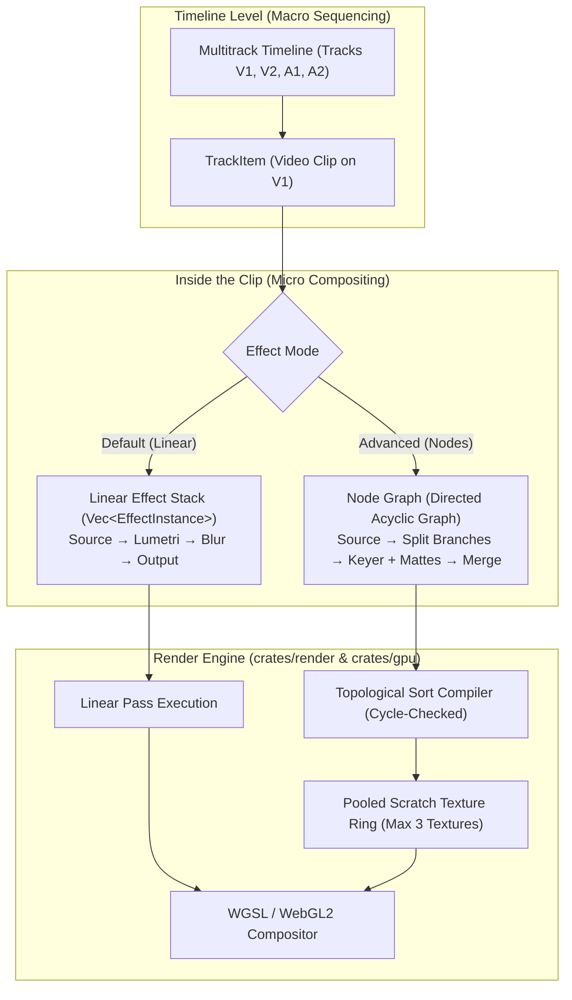

# Implementation Plan: Hybrid Timeline & Node-Graph Compositor System

## Goal Description
Evaluate, architect, and plan the integration of a **Node-Graph Compositor** alongside FilmCraft's existing **Multitrack Timeline**. 

Currently, FilmCraft processes effects on clips as a sequential linear vector (`pub effects: Vec<EffectInstance>`), matching Adobe Premiere's Effect Controls panel (Clip $\rightarrow$ Effect 1 $\rightarrow$ Effect 2 $\rightarrow$ Output). 
The goal is to allow advanced video editors to create **branching, multi-input, parallel effect graphs** (like DaVinci Fusion, Blender Compositing, or Nuke) inside clips or adjustment layers, while preserving the speed, simplicity, and 120Hz responsiveness of the standard timeline.

---

## User Review Required

> [!IMPORTANT]
> **Is a Node System actually useful for your editing?**
> - **For 90% of normal video editing** (color grading, audio EQ, crops, speed ramps, basic blurs, sharpening), a linear effect stack is **faster, cleaner, and less confusing**.
> - **For advanced VFX & motion graphics** (green screen keying, multi-pass background replacement, custom light wraps, glow branching, complex masking), a node system is **exponentially more powerful** than timeline track stacking.
>
> **Our Recommended Design:** We propose a **Dual-Mode Container System** (identical to DaVinci Resolve + Fusion):
> 1. By default, every clip displays the simple, fast **Effect Controls / Inspector stack**.
> 2. An **"Open in Node Graph"** toggle unfolds the clip into a visual node canvas for complex branching when needed.
> 3. Normal editing remains 100% lightweight and instant; advanced compositing is available on demand.

> [!WARNING]
> **VRAM & Browser Crash Prevention (Web/WASM):**
> On the web, browsers enforce strict GPU memory limits (~512MB to 1GB). Naively creating 10 node branches in 4K resolution would allocate over 300MB of uncompressed frame textures, crashing the WebAssembly tab.
> Our plan enforces an **Immediate-Mode Ping-Pong Texture Pool**: nodes share a scratch ring buffer of at most 3 working textures, recycling memory as branches resolve.

---

## Architecture Overview: How the Hybrid System Works



---

## Open Questions

> [!IMPORTANT]
> 1. **Scope Priority:** Would you prefer to start with **Phase 1: Multi-Effect Layer Blending & Parallel Stacks** (which allows stacking and blending effects in the right-hand Inspector without wiring nodes), or jump straight to the **Full Visual Wire/Node Graph Canvas**?
> 2. **Node Granularity:** Should nodes be **High-Level Effects** (e.g., Blur Node, Lumetri Node, Transform Node, Merge Node) or **Low-Level Math** (Math Node, Separate RGBA, Invert)? We strongly recommend *High-Level Effect Nodes* to prevent clutter.

---

## Technical Feasibility & Difficulty Breakdown

| Layer | Technical Difficulty | What Needs to be Built | Potential Pitfall | Solution |
|---|---|---|---|---|
| **1. Data Model** (`crates/project`) | **Low** (~2 days) | `NodeGraph`, `Node`, `Pin`, `Connection` structs with Serde JSON schema. | Breaking older `.fcproj` files. | Make `graph: Option<NodeGraph>` optional with `#[serde(default)]`. |
| **2. Topological DAG Compiler** (`crates/render`) | **Medium** (~3-4 days) | Kahn's algorithm or DFS topological sort to linearize nodes into execution batches. | Infinite loops from cyclic connections. | Instant cycle detection upon wire connection (refuse edge if cycle forms). |
| **3. Memory & VRAM Pool** (`crates/gpu`) | **High** (~4 days) | Bounded texture ring buffer that frees intermediate branch buffers immediately after child consumption. | Browser WebGL Out-Of-Memory crashes. | Cap node tree resolution and reuse existing `TexturePool` in `crates/gpu`. |
| **4. egui Node Canvas UI** (`crates/ui-egui`) | **Medium** (~4-5 days) | Interactive pan/zoom canvas, draggable node cards, bezier noodle wires, pin snapping. | Clunky mouse interaction or wire latency. | Immediate-mode painter using `egui::epaint::CubicBezierShape`. |
| **5. Co-Op Multiplayer Sync** | **Low-Medium** (~2 days) | Broadcast node moves and connections over WebSocket rooms. | Flooding network on node dragging. | 32ms throttled drag updates, matching our Ticket 1 playhead throttler. |

---

## Proposed Changes

### Component 1: Project Data Model (`crates/project`)
Define the node graph schema that lives inside any `TrackItem`.

#### [MODIFY] `crates/project/src/lib.rs`
- Add `pub graph: Option<NodeGraph>` to `TrackItem`.
- When `graph` is `None`, the item executes its standard `effects: Vec<EffectInstance>`.

#### [NEW] `crates/project/src/node_graph.rs`
```rust
use serde::{Deserialize, Serialize};
use std::collections::BTreeMap;
use filmcraft_geom::Vec2;
use crate::EffectInstance;

#[derive(Clone, Copy, Debug, PartialEq, Eq, Hash, Serialize, Deserialize)]
pub struct NodeId(pub u64);

#[derive(Clone, Copy, Debug, PartialEq, Eq, Hash, Serialize, Deserialize)]
pub struct PinId(pub u32);

#[derive(Clone, Copy, Debug, PartialEq, Eq, Serialize, Deserialize)]
pub enum PinKind {
    ImageInput,
    ImageOutput,
    MaskInput,
    ValueInput,
}

#[derive(Clone, Debug, PartialEq, Serialize, Deserialize)]
pub struct NodePin {
    pub id: PinId,
    pub name: String,
    pub kind: PinKind,
}

#[derive(Clone, Debug, PartialEq, Serialize, Deserialize)]
pub enum NodeOp {
    /// Ingest the raw video clip frame.
    SourceInput,
    /// Standard video effect (Lumetri, Gaussian Blur, etc.).
    Effect(EffectInstance),
    /// Merge two image inputs using a blend mode (Normal, Multiply, Screen, Overlay).
    Merge { blend_mode: String, opacity: f32 },
    /// Split channels or create matte masks.
    ChannelMask { channel: String },
    /// Final output sent to timeline compositor.
    FinalOutput,
}

#[derive(Clone, Debug, PartialEq, Serialize, Deserialize)]
pub struct Node {
    pub id: NodeId,
    pub title: String,
    pub op: NodeOp,
    pub pos: Vec2, // Canvas coordinate for UI
    pub inputs: Vec<NodePin>,
    pub outputs: Vec<NodePin>,
}

#[derive(Clone, Debug, PartialEq, Serialize, Deserialize)]
pub struct Connection {
    pub from_node: NodeId,
    pub from_pin: PinId,
    pub to_node: NodeId,
    pub to_pin: PinId,
}

#[derive(Clone, Debug, Default, PartialEq, Serialize, Deserialize)]
pub struct NodeGraph {
    pub nodes: BTreeMap<NodeId, Node>,
    pub connections: Vec<Connection>,
    pub next_node_id: u64,
}

impl NodeGraph {
    /// Cycle detection: returns false if adding this connection would create an infinite loop.
    pub fn can_connect(&self, from: NodeId, to: NodeId) -> bool {
        if from == to { return false; }
        // DFS search from `to` reaching `from`
        let mut visited = std::collections::HashSet::new();
        let mut stack = vec![to];
        while let Some(current) = stack.pop() {
            if current == from { return false; }
            if visited.insert(current) {
                for conn in &self.connections {
                    if conn.from_node == current {
                        stack.push(conn.to_node);
                    }
                }
            }
        }
        true
    }
}
```

---

### Component 2: DAG Topological Execution Engine (`crates/render`)

#### [NEW] `crates/render/src/graph_exec.rs`
- Compiles the `NodeGraph` into an execution schedule.
- Allocates intermediate working textures from a small scratch pool.
- Frees upstream branch textures the moment all downstream child nodes finish reading them.

```rust
pub struct ExecPlan {
    pub order: Vec<NodeId>,
}

impl ExecPlan {
    pub fn compile(graph: &NodeGraph) -> Result<Self, &'static str> {
        // Kahn's algorithm for topological sorting
        // Ensures dependencies are executed before consumers
        let mut in_degrees: HashMap<NodeId, usize> = HashMap::new();
        for node in graph.nodes.values() {
            in_degrees.insert(node.id, 0);
        }
        for conn in &graph.connections {
            *in_degrees.entry(conn.to_node).or_default() += 1;
        }

        let mut queue: VecDeque<NodeId> = in_degrees
            .iter()
            .filter(|&(_, deg)| *deg == 0)
            .map(|(&id, _)| id)
            .collect();

        let mut order = Vec::new();
        while let Some(id) = queue.pop_front() {
            order.push(id);
            for conn in &graph.connections {
                if conn.from_node == id {
                    let deg = in_degrees.get_mut(&conn.to_node).unwrap();
                    *deg -= 1;
                    if *deg == 0 {
                        queue.push_back(conn.to_node);
                    }
                }
            }
        }

        if order.len() != graph.nodes.len() {
            return Err("Cycle detected in effect node graph");
        }
        Ok(ExecPlan { order })
    }
}
```

---

### Component 3: Node Graph Editor UI (`crates/ui-egui`)

#### [NEW] `crates/ui-egui/src/panels/node_graph.rs`
- A dedicated docking panel (`PanelKind::NodeGraph`).
- Renders in the middle or right pane when a clip is selected and "Nodes" mode is toggled.
- Features:
  - **Infinite Canvas Pan & Zoom** (Middle click drag, scroll wheel zoom).
  - **Node Cards:** Draggable `#202126` charcoal cards with input sockets on the left and output sockets on the right.
  - **Bezier Noodles:** Curved spline connectors drawn with `painter.add(CubicBezierShape)`.
  - **Socket Snapping:** Dragging a wire near a compatible pin snaps and highlights green.

---

## Phased Rollout Plan

### Phase 1: Inspector Layer Stacking & Blend Modes (Fast Win · ~1-2 days)
* Allow multiple effects on a clip to have individual **Blend Modes** (Multiply, Screen, Overlay, Add) and **Opacity Sliders** in the existing Inspector.
* Solves 70% of "layered effects" needs immediately with zero risk of graph complexity.

### Phase 2: Node Graph Data Model & Topological Engine (~3 days)
* Implement `NodeGraph` struct in `crates/project`.
* Write unit tests for cycle detection, topological execution ordering, and serde round-trips.
* Connect `graph_exec` to `filmcraft_render` with bounded scratch texture pooling.

### Phase 3: Visual Node Canvas UI (~4 days)
* Build `panels/node_graph.rs` in `crates/ui-egui`.
* Add canvas drag/drop, pin wire connections, and context menu ("Add Effect Node", "Add Merge Node").
* Integrate with `Undo/Redo` transactions.

---

## Verification Plan

### Automated Tests
1. **Topological Order Test:** Verify that complex diamond-pattern graphs ($A \rightarrow B, A \rightarrow C \rightarrow D, B \rightarrow D$) execute in valid dependency order.
2. **Cycle Prevention Test:** Ensure `can_connect` strictly rejects loops ($A \rightarrow B \rightarrow A$).
3. **Memory Bound Test:** Verify that evaluating a 10-node branching graph never holds more than 3 scratch textures simultaneously in VRAM.
4. **Backward Compatibility Test:** Load existing v0.10.0 `.fcproj` files and verify they render identically without graphs.

### Manual Verification
1. Open a clip, add a Source Node, branch it into Lumetri (High Contrast) and Blur (Radius 20), plug both into a Merge Node (Screen 50%), and verify the resulting image in the Program Monitor.
2. Verify interactive wire dragging at 60/120 FPS on both native desktop and WebAssembly/GitHub Pages.
