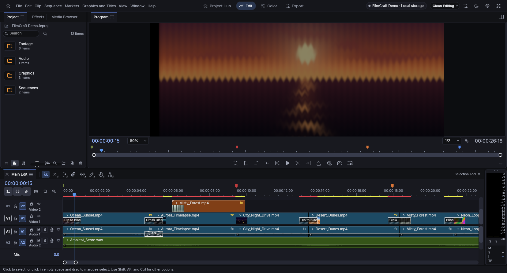
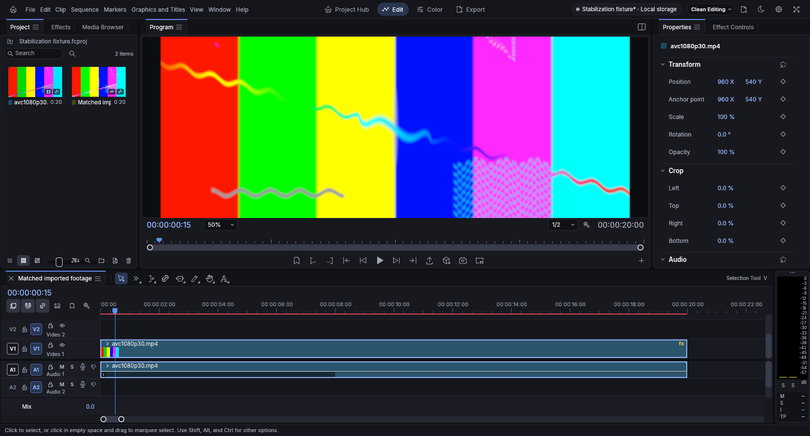
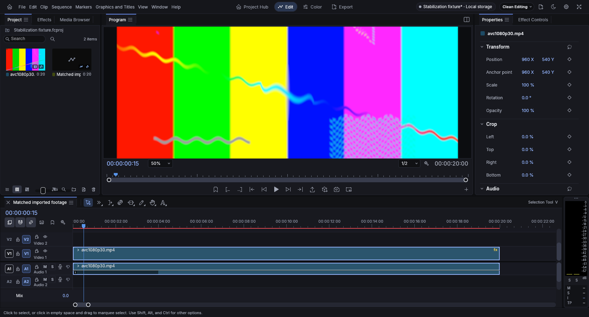

# Independent frame worker: real Chrome evidence

Unmodified Chrome captures of the real Rust/egui application at 1656×894, DPR 1,
dark Clean Editing, Half preview resolution and sequence frame 15. No mock UI or
generated screenshot artwork. Both builds keep all authored effects enabled.

| Workload | V7.9 cooperative baseline | Independent worker |
|---|---|---|
| Ocean Sunset, existing seven effects and Position/Opacity animation |  |  |
| Synthetic imported 1080p AVC, Lumetri + Blur + Wave Warp + Spherize |  |  |

Captured from the first accepted matched repeat. The screenshots demonstrate
actual pictures and retained UI; they do not demonstrate FPS or input latency.
The Ocean project contents and recovery state remain private and are not included.
The imported test pattern was generated locally with an external fixture tool.
All visible media and FilmCraft artwork are original/open project content.

See [the performance ledger](../../performance-stabilization.md) and
[measurement definitions](../../performance-stabilization-reproduction.md).
