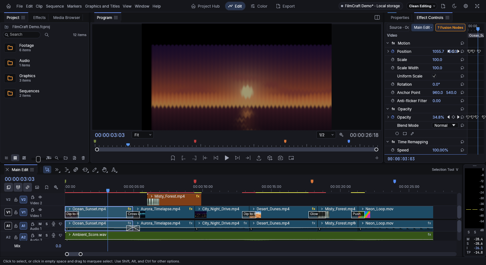

# Enabled Ocean effect stack: before and after

Real Chrome captures at 1536×838, sequence frame 75, fitted Program view. Lumetri, Blur, Wave Warp and zero-radius Spherize remain enabled; Position/Opacity animation is preserved. The change accelerates processing while preserving the authored picture.

| CPU fallback before | GPU chain after |
|---|---|
|  |  |

Program-picture comparison includes clip outlines: 99th-percentile maximum 8-bit channel difference **1**, mean **0.077**, worst **17** at a small number of outline samples. Full UI/audio-meter regions are excluded. [Verification and benchmark details](../../verification/v7-ocean-stack-gpu.json).
